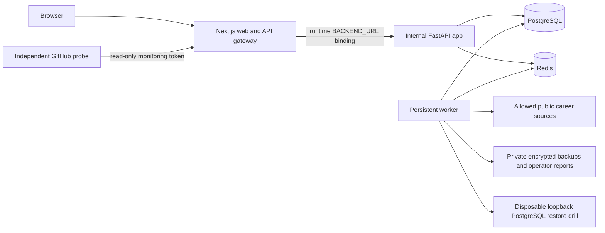

# 02 · System architecture

Baseline: November 21, 2026. Detailed reference: [architecture](../docs/ARCHITECTURE.md).

## Component inventory

| Component | Source | Runtime / responsibility |
| --- | --- | --- |
| UI | apps/web/app and components | Next.js App Router, React, TypeScript, local fonts; public brand/search/private workspace |
| Gateway | apps/web/app/api/[...path]/route.ts; apps/web/proxy.ts | Same-origin API forwarding, bounded bodies, trusted proxy signatures, nonce CSP |
| API | app.py; backend/vindex/api.py; accounts/api.py | FastAPI, public search and protected operator/private routes |
| Connectors | backend/vindex/connectors | Exact source detection, bounded native requests, complete enumeration |
| Scheduler | backend/vindex/worker.py; scripts/start_production_worker.py | Persistent due-source scheduling, two cloud slots, leases, transactions |
| Staged collection | jobiqo_refresh.py, madgex_refresh.py, talenetic_refresh.py | SQL checkpoints for large collections; no partial publication |
| Data | backend/vindex/db.py and accounts/models.py | SQLAlchemy models; Alembic migrations own schema changes |
| Hosted supervision | backend/vindex/hosted_operations.py | Heartbeat-independent monitoring, daily backups and one-shot operator review |
| Recovery | scripts/backup_database.py; scripts/cloud_backup.py | AES-256-GCM export, private Blob upload, local isolated restore/count check |

## Data lifecycle

A supported URL becomes a validated provider/tenant identifier and a persistent
source schedule. The collector enumerates the complete source, validates typed
records and returns an explicit complete batch. Ingestion atomically updates
canonical jobs, per-source observations, lifecycle state and change events.
Partial batches, errors and conflicting payloads do not publish a replacement
snapshot or close records. A complete absence check must miss a job twice at
least 24 hours apart before closure. Reappearance can reopen it.

Identity is conservative: normalized application URL, company, title and
location. Known tracking parameters are removed; unknown parameters remain.
Different requisitions and locations remain distinct. Active observations can
supply missing useful fields with field-level provenance. Raw observations remain
private; full immutable per-run observation snapshots are not implemented.

Public timestamps distinguish first observation, last content/lifecycle change
and last completed check. A last check during absence grace is not proof that a
job was still open at the source. Missing salary/location/description stays
unknown or flagged; normalization is not evidence of complete upstream content.

## Storage and infrastructure

Production is Vercel `mandtechyt-1124/v-index`: public `web`, internal `app`, and
one 1 GiB `worker` daemon in iad1. External PostgreSQL (observed major 18) stores
jobs/private encrypted files. Redis supplies source leases, sessions/state/rate
support, heartbeats and operator status. Private Blob in iad1 stores encrypted
snapshots and bounded operator reports. Local SQLite and Compose are evaluation
alternatives, never deployment data sources.

Search uses parameterized JSON substring filters with PostgreSQL pg_trgm indexes
and deterministic descending IDs. There is no Elasticsearch/Airflow dependency,
vector search or message-broker requirement. Browser polling is separate from
upstream collection. No latency, scale or uptime guarantee follows from this
architecture alone.
